

  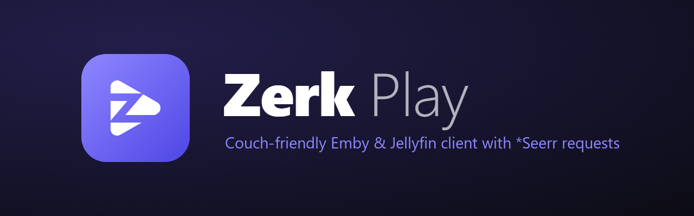

  An Emby / Jellyfin client for <b>Windows</b> and <b>Android TV / Google TV</b>, 
  built around discovery and Jellyseerr / Overseerr requests.

  
  &nbsp;
  

  <a href="https://github.com/florinp93/Zerk-Play-2.0/releases/download/v2.0.0/ZerkPlay-Public-Windows-setup.exe"><b>Download for Windows</b></a>
  &nbsp;·&nbsp;
  <a href="https://github.com/florinp93/Zerk-Play-2.0/releases/download/v2.0.0/ZerkPlay-Public-Android.apk"><b>Download for Android TV</b></a>
  &nbsp;·&nbsp;
  <a href="https://github.com/florinp93/Zerk-Play-2.0/releases">All releases</a>

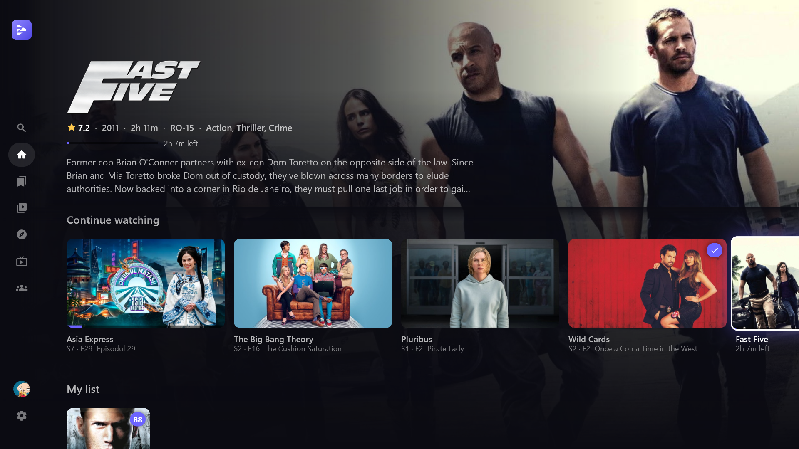

Zerk Play 2 is a full rewrite, and this is its first public release. It's still in beta, so expect rough edges and please report anything that breaks.

When you open it, it should help you find something to watch, not leave you scrolling a library grid. If what you want isn't on the server yet, you can request it from the same screen.

## Discovery first

Home is built from your watch history, not just "Latest added":

- **Because you watched…** suggestions based on what you actually finished
- **What are you in the mood for?** theme rows like *Coming of age*, *Against all odds*, *Whodunits* and *Heists & cons*, each showing how many titles you already have
- **Picked for you**, plus rows built from your taste (*Because you like Action · Comedy*)
- **Top 10 trending**, with a big-number row like the streaming services have

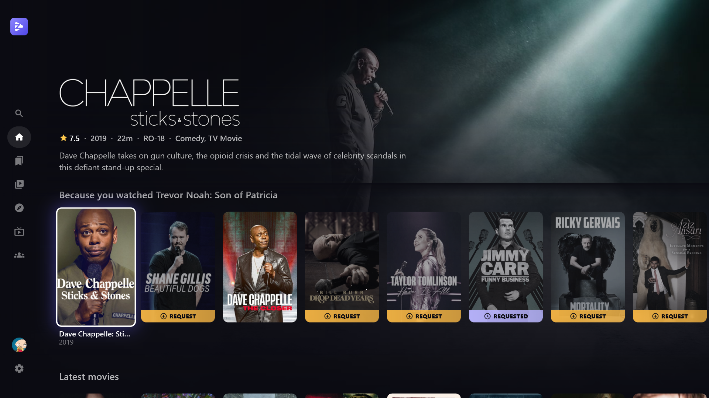

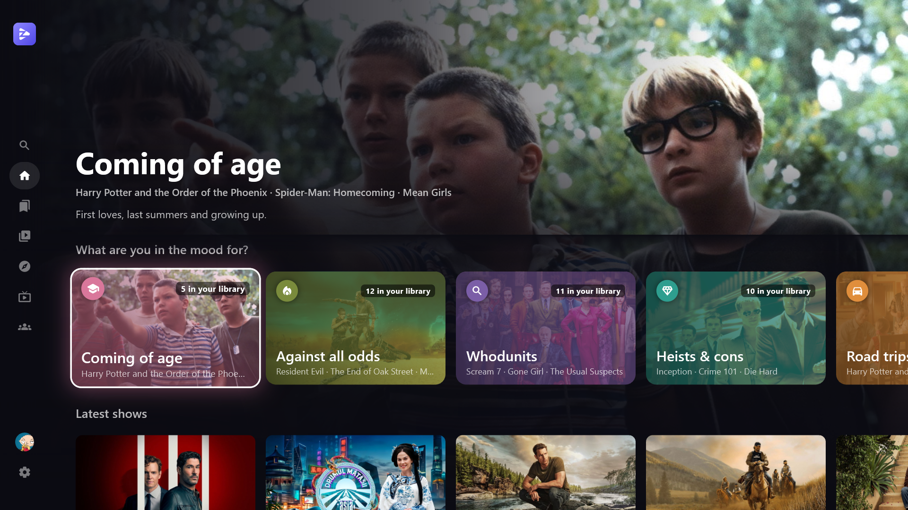

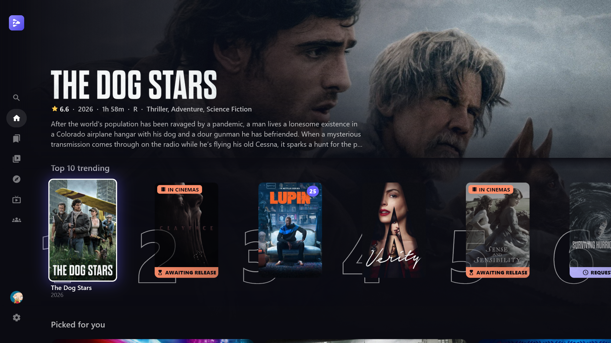

Every title has **tags** (from TMDB keywords: *Heist*, *Hitman*, *Based on a true story*…). Open a tag to see everything that matches, starting with what's already in your library. Each details page also has **More like this**, and trailers play in the background while you read.

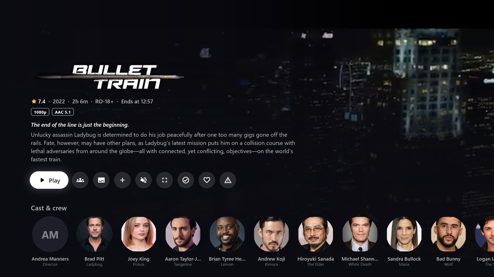

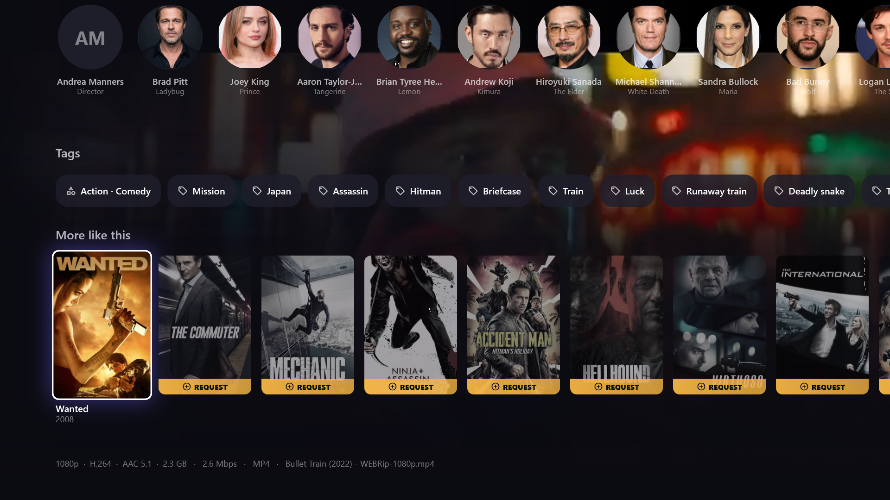

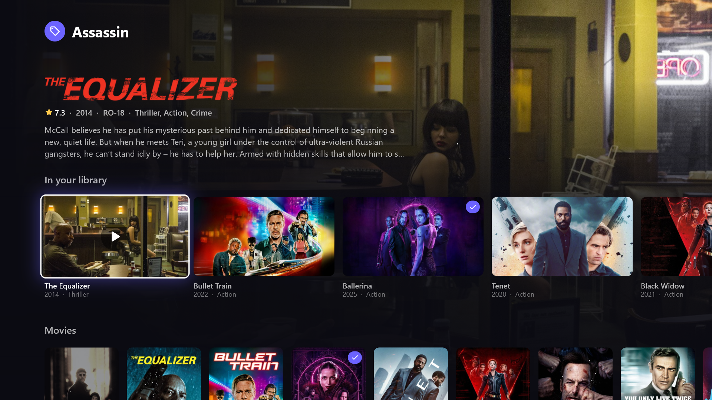

There's also a **Discover** tab (trending, popular, coming soon), a **Calendar** of upcoming releases, and **Collections** built from TMDB, even if your server doesn't group them.

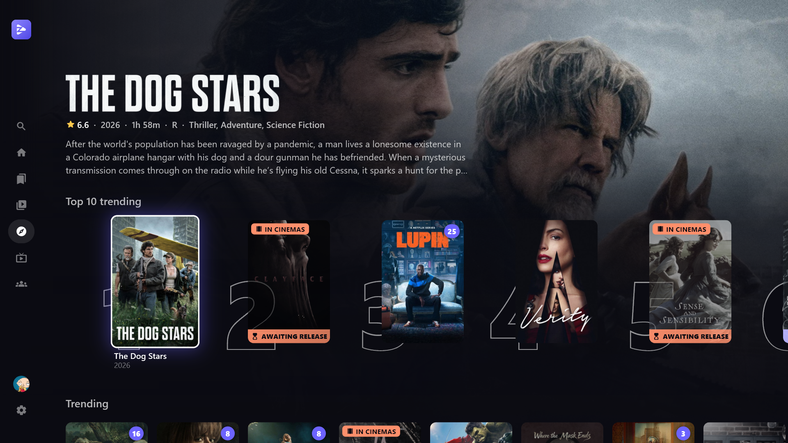

## Requests built in (Jellyseerr / Overseerr)

Connect Jellyseerr or Overseerr and titles you don't have show up right next to the ones you do:

- A **Request** badge on anything not in your library, in every row: home, Discover, search, More like this
- One **Request** page: pick the seasons, watch the trailer, done
- **Search** shows your library first, then a *Not in your library* row you can request from
- **Requested** and **Awaiting release** badges, so you can see what's on the way

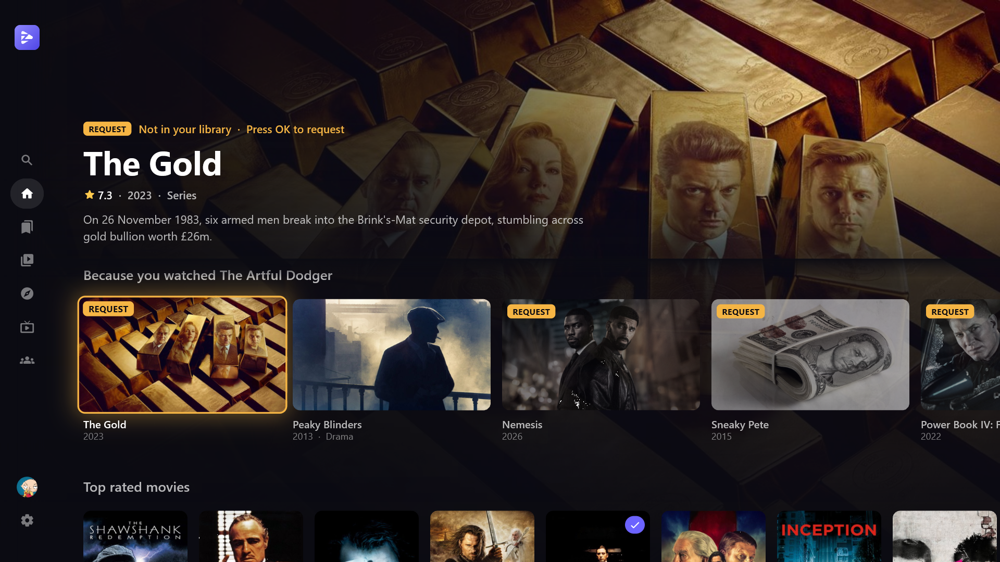

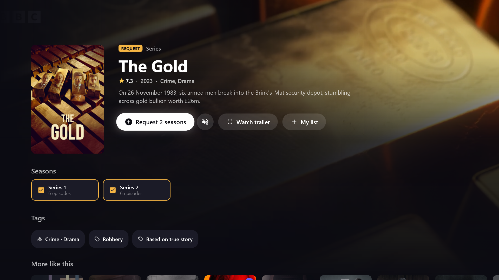

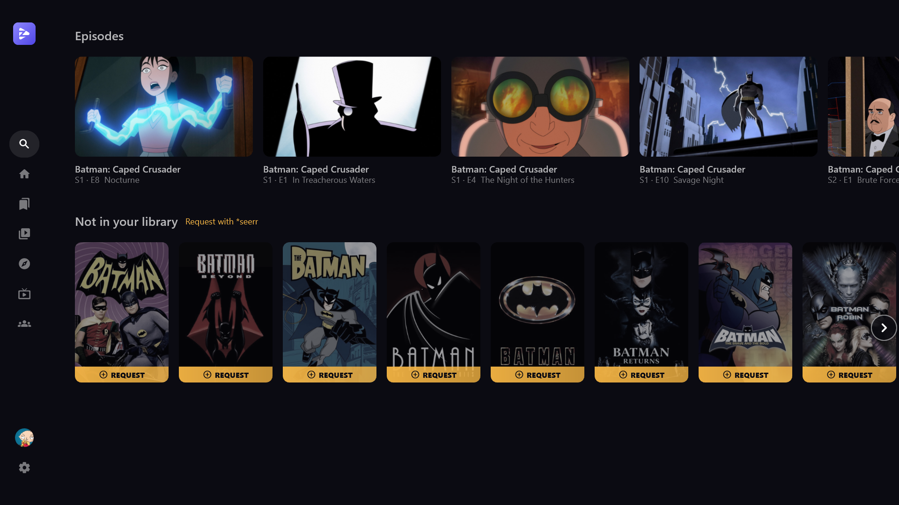

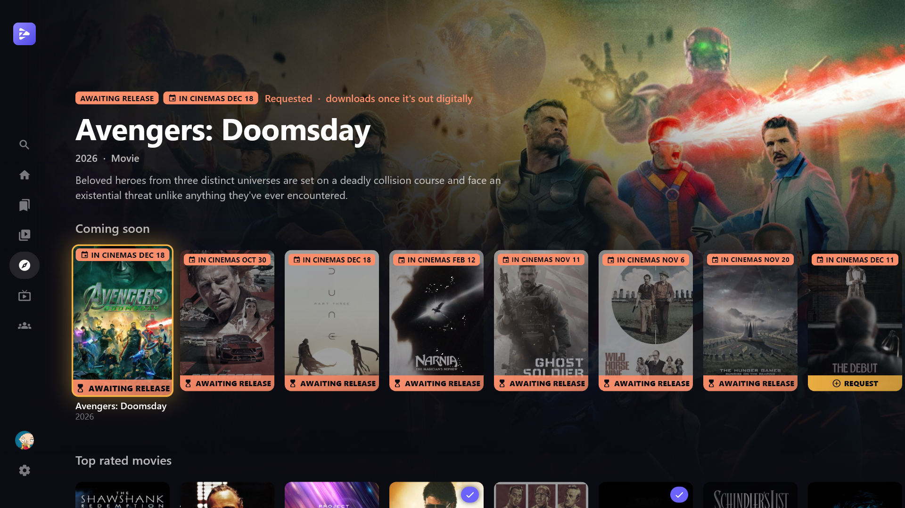

## Playback

- **Windows:** mpv (libmpv, gpu-next on D3D11) with real **HDR** output. It can switch Windows HDR on for HDR videos and back off afterwards. Audio passthrough to your receiver (TrueHD, DTS-HD MA, EAC3…).
- **Android TV:** a native Media3 player with an FFmpeg audio decoder, plus passthrough settings for your TV / soundbar / receiver.
- **Versions:** if a movie has several files (1080p, 2160p Dolby Vision…), you can pick one and the app remembers your choice.
- **Skip intro**, manually or automatically.
- **Subtitles:** a *Smart* mode (your language, or forced subtitles for foreign dialogue), size and style options, and a delay setting.
- TMDB metadata **in your language** (titles, descriptions, logos, artwork) without touching your server's libraries.

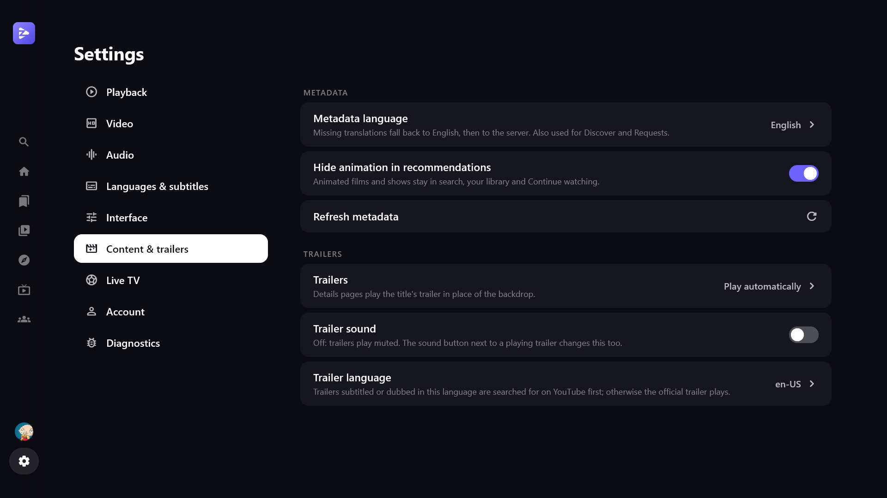

## Live TV

Add your own Xtream Codes IPTV account to get a proper **TV guide**: channel groups, an EPG timeline and what's on now. Live TV works next to your movie library in the same app.

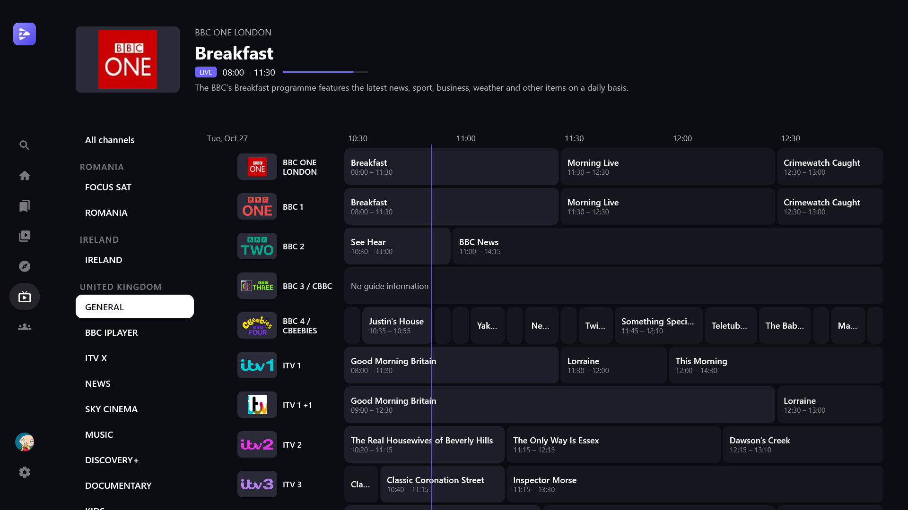

## Made for the couch

The whole UI is driven by **D-pad / remote / keyboard** first. It works on Windows too: plug in a gamepad or use the arrow keys, and the mouse cursor hides itself until you move it again. The mouse still works everywhere, with hover and wheel scrolling.

Setup on a TV is painless: **scan a QR code with your phone** and fill in the server, TMDB key and Jellyseerr details there instead of typing with a remote.

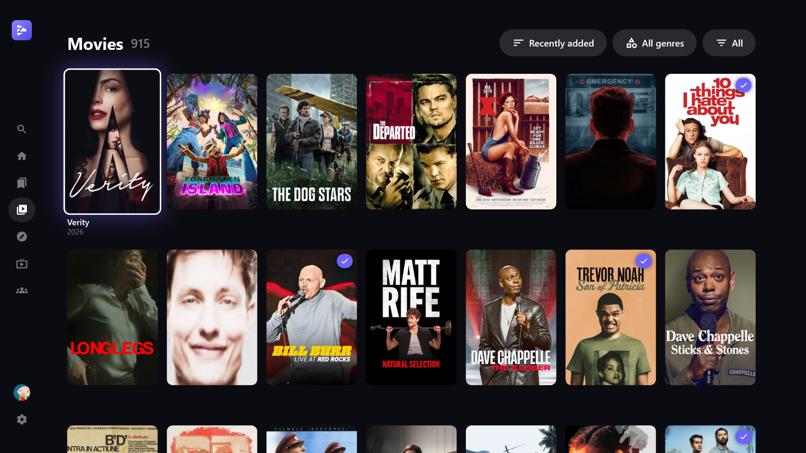

## Getting started

1. Download the [Windows installer](https://github.com/florinp93/Zerk-Play-2.0/releases/download/v2.0.0/ZerkPlay-Public-Windows-setup.exe) or the [Android TV APK](https://github.com/florinp93/Zerk-Play-2.0/releases/download/v2.0.0/ZerkPlay-Public-Android.apk).
2. On first start, choose **Emby or Jellyfin** and sign in.
3. *(Optional)* Add a free **TMDB API key** for metadata in your language, tags and collections.
4. *(Optional)* Add your **Jellyseerr / Overseerr** address and API key for requests.

> The \*seerr address has to be reachable from the device running Zerk Play. Don't use `localhost` unless \*seerr runs on that same machine.

## Good to know

- **Jellyfin support is brand new.** It was developed against Emby and has only been tested lightly with Jellyfin. Please report anything that breaks.
- The APK isn't on the Play Store: install it with Downloader, Send Files to TV, or adb.
- Tested on Windows 11 and a Chromecast with Google TV 4K. Other Android TV boxes should work; reports are welcome.
- You bring your own servers and API keys. Nothing is hardcoded in the public build.
- Zerk Play is not affiliated with Emby, Jellyfin, Jellyseerr, Overseerr or TMDB.

Feedback, bug reports and feature ideas are very welcome: open an issue or join the Discord.
